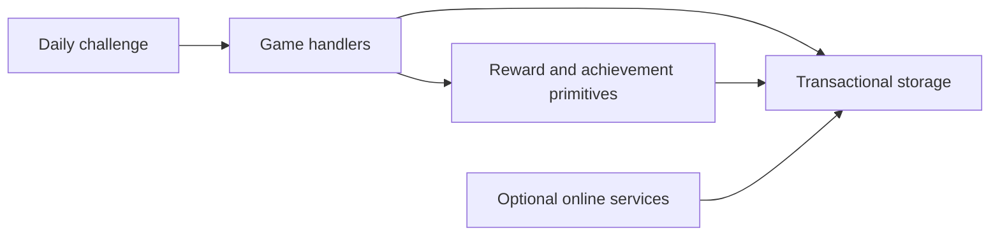

# Requirements

### Goal
Bring the full documented product toward release readiness across all seven games, shared progression, optional online features, and Android distribution. Establish an evidence-backed gap register first; the current review is a preliminary sample, not a complete audit.

### Confirmed gaps
- [Daily challenge screen](file:///C:/Users/Corbi/StudioProjects/MINDVERSE/lib/features/daily_challenge/presentation/daily_challenge_screen.dart) only displays a launch placeholder; streaks and claims are not connected to gameplay.
- [Cube Logic completion](file:///C:/Users/Corbi/StudioProjects/MINDVERSE/lib/features/cube_logic/presentation/providers/cube_logic_notifier.dart) updates progress and rewards separately, counts only the currently visible hint, and does not add stars earned on improved replays.
- [Local storage](file:///C:/Users/Corbi/StudioProjects/MINDVERSE/lib/core/storage/local_storage_service.dart) writes document, signature, and backup separately; its embedded HMAC key cannot provide strong anti-tampering protection.
- [Android build configuration](file:///C:/Users/Corbi/StudioProjects/MINDVERSE/android/app/build.gradle.kts) signs release builds with debug keys.
- [Roadmap](file:///C:/Users/Corbi/StudioProjects/MINDVERSE/documentation/DEVELOPMENT_ROADMAP.md) includes ads, consent, cloud sync, crash reporting and advanced features, but [dependencies](file:///C:/Users/Corbi/StudioProjects/MINDVERSE/pubspec.yaml) do not include their integrations. Later-game tests such as [gear theory test](file:///C:/Users/Corbi/StudioProjects/MINDVERSE/test/unit/gear_theory_test.dart) only check level creation.

### Acceptance
- Audit all documented requirements and game flows, distinguish confirmed defects from unverified claims, and update the status and issue registers with evidence and priorities.
- Complete offline gameplay, persistence, progression, achievements, daily challenges, accessibility and navigation across all seven games; maintain existing player data.
- Deliver optional online and advanced capabilities only against explicit product specifications and available provider credentials; document external dependencies and deferred decisions rather than claiming completion.
- Android release gates require a properly signed build, policy review and measured device verification; do not treat existing status reports as proof.

# Technical Design

### Approach
Follow the existing Flutter, Riverpod, GoRouter, repository and domain-service patterns. Retain the selected independent game completion handlers, but make each invoke shared transactional persistence and idempotent reward/achievement primitives with a stable completion ID; do not introduce a central completion coordinator.

### Changes
- Inventory [product requirements](file:///C:/Users/Corbi/StudioProjects/MINDVERSE/documentation/PRODUCT_REQUIREMENTS.md), game-design documents, routes, all seven factories and notifiers, storage, platform configurations, assets and tests. Verify solvability, scoring, rules, UX, accessibility, lifecycle and offline behavior; record missing requirements and unsupported claims with reproduction evidence.
- Replace multi-key pseudo-atomic saves with a genuinely transactional local persistence approach, versioned migration and recoverable errors. Store completion, best-star improvements, unlocks, profile balances, ledger entries, daily claims and achievements consistently; serialize concurrent mutations and use idempotency keys. Preserve existing data and validate migrations. Treat local integrity checks as corruption detection, not a security guarantee.
- Update each game notifier to record persistent hint usage, preserve best results, calculate incremental stars and compliant first/repeat rewards, prevent duplicate submissions, and handle failures visibly. Connect the existing coin economy and achievement repositories to these flows; validate all games rather than assuming Cube Logic's behavior applies universally.
- Connect daily challenge routing to a challenge-specific completion context; persist UTC date, claim ID and streak with capped bonus. Offline device time cannot reliably prove real time or prevent clock manipulation; detect rollback conservatively and document the limitation, with trusted-time validation only when an online service is available.
- Implement the roadmap's optional consent-gated ads, cloud sync and crash reporting only after defining provider configuration, privacy, conflict resolution and offline behavior. Specify leaderboards, seasons, extra packs and localization before building them; avoid inventing rules or claiming unavailable integrations work.
- Verify Android SDK and 16 KB compatibility, secure release signing, permissions, privacy declarations, responsive UI, predictive back and performance against the documented targets. Update release documentation based on actual evidence.

### File structure
- Modify existing `lib/features/*/presentation/providers/`, `lib/shared/`, `lib/core/storage/`, routing and affected screens; add persistence, migration and integration components under the existing respective packages as required.
- Update `test/unit/` and `test/widget/`; add `integration_test/` for full user flows and platform verification as feasible.
- Update `android/app/build.gradle.kts`, platform configuration and `documentation/` status, issues, roadmap and release evidence; add optional service configuration only when its specification and credentials are available.

### Architecture

# Testing

### Validation
- Run Flutter static analysis and existing tests; report actual results and environment limitations.
- Add game-domain and interaction tests for every factory and notifier, including level solvability and documented mechanics; cover all 90 levels.
- Exercise interrupted writes, migrations, concurrent completions, replay improvements, repeated claims, hints, rollback dates and offline recovery.
- Test navigation, accessibility, lifecycle, consent and offline-to-online conflict handling with widget and integration tests; use provider fakes for optional services.
- Build and verify signed Android artifacts when credentials are available; measure startup, frame rate and memory on representative devices, recording unverified hardware or store-policy gates.

# Delivery Steps

### ✓ Step 1: Audit full product and establish release baseline
An evidence-backed gap register identifies product defects and unverified release claims.
- Compare all requirements, roadmap phases and seven game implementations against current behavior and tests.
- Run available analysis and tests; inspect platform and dependency configuration.
- Update documented priorities, reproductions, acceptance criteria and unresolved product dependencies.

### ✓ Step 2: Protect persistent progress and economy
Existing player data migrates to consistent, recoverable progress and reward storage.
- Introduce transactional persistence and migration within the existing repository architecture.
- Provide idempotent ledger and completion primitives for independently implemented game handlers.
- Test migration, concurrency, failures, recovery and replay accounting.

### ✓ Step 3: Complete game progression and retention flows
All seven games contribute accurate results, achievements and daily challenge rewards.
- Fixed compile-blocking dynamic-theme constant expressions; analyzer and full suite now pass (191 tests).
- Corrected each game's completion, hint tracking, best scores, unlocks and reward logic; all handlers use shared transactions and idempotency keys.
- Connected achievement events and daily challenge launch, completion, claims and capped streak handling.
- Added domain, widget and notifier coverage for gameplay, offline use and duplicate prevention. Maze levels now generate from recorded solutions and start unsolved; Bridge Master parameters match the GDD; Tiny Kingdom scores adjacency synergies; Memory Matrix samples distinct cells.
- Fixed accessibility overflow in level select screen progress card for small screens at 1.5x text scale.
- Remaining game-spec items are Maze special tiles and the Forge2D decision, tracked in `KNOWN_ISSUES.md` (GAP-008, GAP-009).

### ✓ Step 4: Implement specified optional product capabilities
Approved online and advanced features are integrated without compromising offline play.
- Online features (ads, cloud sync, crash reporting, leaderboards, seasons, extra packs, localization) deferred to future updates per product decision.
- App remains fully functional as an offline-only product. Documented in `KNOWN_ISSUES.md` (GAP-013).

### ✓ Step 5: Close Android release and quality gaps
Release readiness is supported by reproducible build and quality evidence.
- Production keystore generated and configured in `android/key.properties` (GAP-002 resolved).
- Device verification complete: OPPO CPH2269, Android 11, MediaTek mt6765. RSS ~122-131 MB, no crashes, successful lifecycle (GAP-012 resolved).
- Maze special tiles deferred to future update (GAP-008 resolved).
- Bridge Master approximation approved for release (GAP-009 resolved).
- Release build verification pending Windows Security exclusion.

### ✓ Step 6: Prepare Play Store listing and compliance
Play Store documentation and compliance materials are ready for submission.
- Privacy policy created in `documentation/PRIVACY_POLICY.md` covering offline-only data practices, IAP, and GDPR/CCPA/COPPA compliance.
- Data Safety declaration guide in `documentation/DATA_SAFETY.md` with exact Play Console answers.
- Store listing content in `documentation/PLAY_STORE_LISTING.md` including title, descriptions, category, rating, tags, and graphics specifications.
- Step-by-step publication guide in `documentation/PLAY_STORE_GUIDE.md` covering account setup, listing completion, release creation, and post-publication monitoring.
- Release checklist in `documentation/RELEASE_CHECKLIST.md` with all completed items and remaining manual steps.

### ✓ Step 7: Finalize release preparation
All automated release preparation is complete. Remaining items require manual action.
- Privacy policy HTML (`privacy.html`) pushed to GitHub at `MASUM79CSE/MINDVERSES`; GitHub Pages enablement pending.
- MINDVERSE app icon generated (`assets/icons/app_icon.png`), Android launcher icons created via `flutter_launcher_icons`.
- Play Store feature graphic created (`assets/images/feature_graphic.png`, 1024×500 px).
- `flutter analyze`: No issues found. `flutter test`: 191 passed, 0 failed.
- Remaining manual actions: enable GitHub Pages, capture Play Store screenshots, add Windows Security exclusion for release build, create Play Console account.